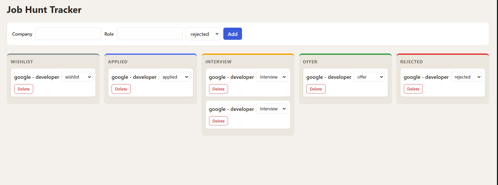

# Job Hunt Tracker

A Kanban-style board to track job applications from wishlist to offer. Everything is saved in the browser, so your board is still there after a refresh.

**Live demo:** [<LINK>](https://ahmed71huz.github.io/job-hunt-tracker/)

## Features
- Add an application with company, role and status
- 5 columns: Wishlist, Applied, Interview, Offer, Rejected
- Move a card to another column with a dropdown
- Delete a card (with a confirmation)
- Data is saved in `localStorage` and loaded when the page opens
- Responsive layout (columns stack on mobile)

## Tech Stack
HTML, CSS (flexbox, custom properties, media queries), vanilla JavaScript, localStorage

## How to Run
1. Clone the repo
2. Open `index.html` in your browser (or use the Live Server extension in VS Code)

## What I Learned
- Keeping the app state in one array of objects and rendering the board from it
- Event delegation: one `click` and one `change` listener on the board, using `closest()` and `data-*` attributes
- Updating data with `find` and `filter`, then re-rendering
- Saving and loading state with `localStorage` and `JSON.stringify` / `JSON.parse`
- Working on a Git feature branch

## Ideas for Next Steps
- Edit a card and add notes, a link and a date
- Counters per column
- Split the code into ES modules
